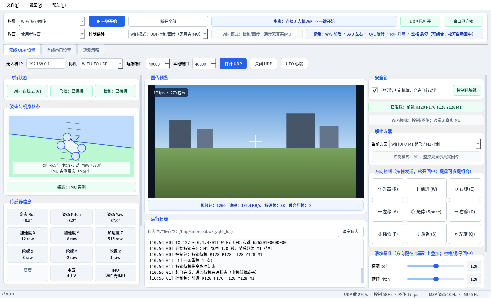
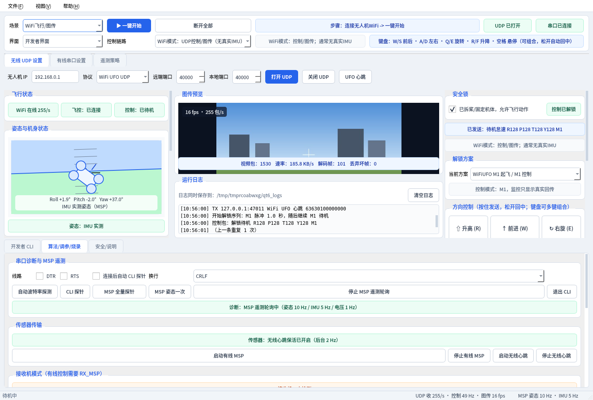

# 无人机上位机（WiFi UFO 地面站）

WiFi UFO 协议小型无人机的 Windows 上位机：**图传预览 + 键盘飞行控制 + 飞控传感器（姿态/IMU/电压）监控 + Cleanflight 调参**。
下载即用，不需要安装 Python。

> ⚠️ **安全第一**：第一次使用、调试飞控或测试控制时，请先**拆掉螺旋桨**或把机体固定住。



---

## 目录

1. [下载](#1-下载)
2. [3 分钟上手：WiFi 图传 + 键盘飞行](#2-3-分钟上手wifi-图传--键盘飞行)
3. [键盘操作](#3-键盘操作)
4. [界面说明](#4-界面说明)
5. [其他使用场景（有线传感器 / 有线控制 / 恢复 WiFi）](#5-其他使用场景)
6. [安全机制](#6-安全机制)
7. [常见问题](#7-常见问题)
8. [从源码运行与打包（开发者）](#8-从源码运行与打包开发者)
9. [协议参考](#9-协议参考)
10. [更新记录](#10-更新记录)

---

## 1. 下载

到 [**Releases 页面**](https://github.com/1405264556/Prone_contron/releases/latest) 下载最新版，二选一：

| 文件 | 说明 |
|------|------|
| `DroneGroundStation-vX.Y.Z.exe` | 单个程序，双击运行 |
| `DroneGroundStation-vX.Y.Z-win64.zip` | 程序 + 说明书，解压后运行 |

- 系统要求：Windows 10 / 11（64 位）。
- 首次运行如果 Windows 提示“已保护你的电脑”，点 **更多信息 → 仍要运行**（程序没有数字签名）。
- 使用有线串口需要 USB 转串口驱动（本机型为 **Silicon Labs CP210x**，Windows 通常会自动安装）。

---

## 2. 3 分钟上手：WiFi 图传 + 键盘飞行

| 步骤 | 操作 | 看到什么说明成功 |
|:---:|------|------|
| ① | **拆桨或固定机体**，给无人机上电 | — |
| ② | 电脑 WiFi 连接无人机热点（如 `WiFiUFO-3BE7F2`） | 电脑获得 `192.168.0.x` 地址 |
| ③ | 双击打开 `DroneGroundStation.exe` | 主界面出现 |
| ④ | 左上角「场景」选 **WiFi飞行/图传**，点 **▶ 一键开始** | 顶部「UDP 已打开」变绿；左侧「WiFi 在线」变绿；中间出现图传画面 |
| ⑤ | 右侧勾选 **安全锁**（“已拆桨/固定机体，允许飞行动作”） | 「控制已解锁」变绿 |
| ⑥ | 点 **🔓 解锁待机** → 确认 | 状态显示「控制：已待机」，电机进入怠速 |
| ⑦ | 用键盘飞行：**W/S 前后，A/D 左右，Q/E 旋转，R/F 升降**，按住生效、松开自动回中 | 右侧「已发送：前进 R128 P176 …」实时变化 |
| ⑧ | 结束时点 **🔒 锁定停机**；危险时点红色 **⚠ 急停** | 电机停转 |

> 💡 如果「解锁待机」后电机没有反应：在右侧「解锁方案」里换一个方案（共 3 种，不同批次的飞控板不一样），再点一次「解锁待机」。
> 程序会**记住**你上次用的场景、IP/端口、串口和解锁方案，下次打开直接点「一键开始」即可。

---

## 3. 键盘操作

| 按键 | 动作 | 按键 | 动作 |
|:---:|------|:---:|------|
| `W` / `↑` | 前进 | `S` / `↓` | 后退 |
| `A` / `←` | 左移 | `D` / `→` | 右移 |
| `Q` | 左旋 | `E` | 右旋 |
| `R` | 升高 | `F` | 降低 |
| `空格` | 悬停：所有控制量回中（含滑块） | | |

- **按住发送、松开回中**，和游戏手柄一样；**可以同时按多个键**，例如 `W + A` = 左前方，`W + R` = 边前进边升高。
- 右侧的方向按钮与键盘完全等效，用鼠标按住即可。
- 「滑块基准」是基础控制量（例如把油门滑块调高一点用来配平），方向键在滑块基础上叠加。
- 在输入框里打字时（如 IP、CLI 命令），按键**不会**触发飞行；点一下图传画面即可把键盘切回飞行控制。
- 快捷键：`F1` 快速上手说明，`F5` 刷新串口，`F12` 切换开发者界面。

---

## 4. 界面说明

```text
┌──────────────────────────────────────────────────────────────────────────┐
│ 场景 [WiFi飞行/图传 ▼] [▶ 一键开始] [断开全部]  步骤提示   UDP状态 串口状态 │ ← 连接栏
│ 界面 [使用者界面 ▼]  控制链路 [...]                 键盘提示              │
│ [无线 UDP 设置] [有线串口设置] [遥测策略]   ← 一般不用改，一键开始会自动配置   │
├──────────────┬──────────────────────────────┬────────────────────────────┤
│ 飞行状态      │ 图传预览（左上角显示帧率/包率） │ 安全锁                      │
│ 姿态仪        │                              │ 当前命令 / 控制链路           │
│ 传感器卡片    │ 运行日志                      │ 解锁方案                     │
│ 遥测明细表    │                              │ 方向按钮 / 滑块 / 解锁·锁定·急停 │
├──────────────┴──────────────────────────────┴────────────────────────────┤
│ 状态栏：UDP 收包率 · 控制包频率 · 图传帧率      MSP 姿态频率 · IMU 频率       │
└──────────────────────────────────────────────────────────────────────────┘
```

**颜色约定**：🟢 绿色 = 正常，🟠 橙色 = 等待/注意，🔴 红色 = 未连接/异常。

| 区域 | 说明 |
|------|------|
| 飞行状态 | `WiFi 在线 N/s`（每秒收到的无人机数据包）；超过 2 秒收不到数据会变红「WiFi 丢失」。`飞控` 显示串口连接；`控制` 显示锁定/解锁/待机 |
| 姿态仪 / 传感器 | **只显示真实回传数据**。WiFi 链路不回传姿态，所以只连 WiFi 时这里显示“无真实姿态回传”；要看姿态/IMU/电压需要连接有线串口（见第 5 节） |
| 图传预览 | 自动按比例缩放；下方显示视频包数、速率、解码帧、丢弃坏帧 |
| 运行日志 | 带时间戳；重复内容自动合并；同时保存到日志文件（路径显示在日志上方） |
| 状态栏 | 实时链路质量：正常时控制包约 **50 Hz**，有线姿态约 **10 Hz**、IMU 约 **5 Hz** |
| 开发者界面 | 「界面」切到 **开发者界面**（或按 `F12`）后，底部出现 CLI 控制台、调参、接收机模式、固件预检、安全说明 |



> 截图使用程序自带的模拟无人机/模拟飞控数据生成（`tests/`），实际画面以真机为准。

---

## 5. 其他使用场景

在左上角「场景」中选择，然后点 **▶ 一键开始**。程序会自动配置协议、端口、遥测和控制链路。

| 场景 | 硬件连接 | 能做什么 |
|------|---------|---------|
| **WiFi飞行/图传** | 电脑连无人机 WiFi | 图传、键盘飞行控制（第 2 节） |
| **有线调参/传感器** | USB 线连接飞控 | 实时姿态仪、加速度/陀螺仪、电压；CLI 调参 |
| **有线控电机（需RX_MSP）** | USB 线连接飞控 | 通过串口发送摇杆量控制电机（台架测试用） |
| **恢复WiFi控制（RX_PPM）** | USB 线连接飞控 | 把飞控改回 WiFi 模块控制 |

> 本机型插上 USB 线时 WiFi 模块可能不启动，所以 **WiFi 和有线通常不能同时用**。

### 5.1 有线查看传感器（姿态 / IMU / 电压）

1. USB 线连接飞控（插上后串口会**自动出现**在列表里，无需手动刷新）。
2. 场景选 **有线调参/传感器** → **▶ 一键开始**。
3. 左侧姿态仪开始转动，「姿态：IMU 实测」变绿，传感器卡片实时刷新。

- 串口默认 `115200` 波特率。如果连接后没有数据：开发者界面 →「算法/调参/烧录」→ **自动波特率探测**。
- 拔掉 USB 或飞控重启后，程序会**自动重连**（可在「有线串口设置」里关闭）。
- 如果 3 秒没有传感器数据，日志会提示：飞控可能停在 CLI 模式，点「退出 CLI」即可恢复。

### 5.2 有线控制电机（台架测试）

1. 场景选 **有线控电机（需RX_MSP）** → **▶ 一键开始**，程序会自动读取飞控的接收机模式和**通道映射**（map）。
2. 如果显示「接收机：RX_PPM」，到开发者界面 → **启用有线 RX_MSP**（飞控会保存并重启）。
3. 勾选安全锁 → **🔓 解锁待机**（发送 4 秒摇杆解锁：油门最低 + 偏航最右）→ 用键盘控制。

> 程序按飞控的通道映射（如 `AETR1234`）排列 RC 通道，避免把油门发到错误的通道。没读到映射时会拒绝有线解锁。

### 5.3 恢复 WiFi 控制

用完有线控制后，场景选 **恢复WiFi控制（RX_PPM）** → 一键开始 → 开发者界面点 **恢复 WiFi/RX_PPM**。否则 WiFi 遥控会失效。

---

## 6. 安全机制

| 机制 | 说明 |
|------|------|
| 安全锁 | 默认锁定；不勾选就无法「解锁待机」和发送方向控制 |
| 二次确认 | 解锁、锁定、急停、写入飞控参数、进入 Bootloader 都会弹窗确认 |
| 锁定/急停随时可用 | 「锁定停机」「急停」**不需要**勾选安全锁，任何时候都能发出 |
| 关安全锁 = 锁定 | 飞行中取消勾选安全锁，会自动发送锁定指令 |
| 松键回中 | 松开按键立即回中；**窗口失去焦点**（如切到其他程序）时自动松开所有按键 |
| 防卡死回中 | 后台线程独立以 50 Hz 发控制包；若界面卡住超过 1 秒，后台自动把方向控制回中 |
| 断线保护 | WiFi 超过 2 秒无数据立即提示「WiFi 丢失」；关闭连接前自动补发回中包 |
| 退出保护 | 仍处于解锁状态时关闭程序会提示先锁定 |

> ⚠️ 急停会让电机立即停转，飞行中会**直接掉落**，只在失控或危险时使用。

---

## 7. 常见问题

| 现象 | 解决方法 |
|------|---------|
| 一键开始后「WiFi 等待数据」一直不变绿 | ① 确认电脑已连上无人机热点；② 关闭电脑上的其他上位机/抓包软件（会占用 40000 端口）；③ Windows 防火墙首次运行弹窗时选择**允许**（专用和公用网络都勾选）；④ 关闭 VPN/代理软件 |
| 日志提示「端口可能被其他程序占用」 | 有另一个上位机实例在运行，关掉它；或在「无线 UDP 设置」里改本地端口 |
| 有图传但控制没反应 | 换一个「解锁方案」后重新「解锁待机」；确认右侧状态栏「控制 50 Hz」 |
| 按 W/A/S/D 没反应 | 光标在输入框里——点一下图传画面；或者还没勾选安全锁/解锁待机（右侧「当前命令」会提示原因） |
| 图传卡顿/花屏 | 靠近无人机、远离其他 2.4G 设备；看图传下方「丢弃坏帧」数是否快速增加 |
| 串口列表为空 | 换 USB 线（部分线只能充电）；安装 CP210x 驱动；串口是否被 Betaflight Configurator 等软件占用 |
| 串口连接了但姿态没数据 | 自动波特率探测；或点「退出 CLI」；确认「遥测策略」里勾选了“有线 MSP 传感器” |
| 只连 WiFi 时姿态仪不动 | 正常现象：该 WiFi 模块不回传姿态，需有线连接飞控才能看到 |
| 程序异常 | 菜单「文件 → 打开日志文件夹」，把 `qt6_ground_station_*.log` 和 `crash.log` 发给开发者 |

**日志与设置保存位置**：程序所在目录下的 `runtime\`（日志在 `runtime\qt6_logs\`，设置为 `runtime\settings.ini`）。如果程序放在没有写权限的目录（如 `C:\Program Files`），会自动改存到 `%USERPROFILE%\.drone_ground_station\`。

---

## 8. 从源码运行与打包（开发者）

```powershell
git clone https://github.com/1405264556/Prone_contron.git
cd Prone_contron
python -m venv .venv_qt6
.\.venv_qt6\Scripts\pip install -r requirements.txt
.\.venv_qt6\Scripts\python qt_ground_station\python_qt6\qt_drone_station.py
```

- Python 3.10+；依赖固定为 `PySide6==6.9.2`（6.12.0 实测会在串口线程事件循环中崩溃，升级前请先跑自测）。
- 打包单文件 exe：`.\build_exe.ps1`（输出 `dist\DroneGroundStation.exe`，并自动执行 `--selftest` 自检）。
- 自动发布：推送 `v*` 标签后，GitHub Actions 会在 Windows 上打包、自检并发布到 Releases（见 `.github/workflows/release.yml`）。
- 端到端自测（Linux/macOS，使用模拟无人机 + 模拟飞控，无需硬件）：

  ```bash
  QT_QPA_PLATFORM=offscreen python tests/test_e2e.py
  ```

### 目录结构

```text
Prone_contron/
├── qt_ground_station/
│   ├── python_qt6/
│   │   ├── qt_drone_station.py        # ★ 主程序（PySide6，当前维护版本）
│   │   ├── DroneGroundStation.spec    # PyInstaller 打包配置
│   │   └── run_qt6_ground_station.ps1 # 从源码启动
│   ├── src/ …                         # 早期 C++ Qt 版本（不再同步维护）
│   └── DESIGN_中文.md                 # 早期架构设计文档
├── tests/test_e2e.py                  # 端到端自测（模拟无人机/飞控）
├── docs/                              # 截图、发布说明
├── drone_ground_station.py            # 早期 Tkinter 协议探测工具
├── diagnose_wifi_protocol.py          # WiFi 协议抓包诊断脚本
├── build_exe.ps1                      # 一键打包
└── requirements.txt
```

### 线程模型

| 线程 | 职责 |
|------|------|
| 界面线程 | 只负责显示；日志/遥测/传感器统一以 10 Hz 批量刷新，不会被高频数据拖慢 |
| WiFi 接收线程 | UDP 收包、图传分片重组、JPEG 解码（先限帧再解码，最高 18 fps） |
| WiFi 控制线程 | 按截止时间精确发送 50 Hz 控制包 + 2 Hz 心跳；界面卡顿 1 秒自动回中 |
| 串口线程 | 独立 Qt 事件循环、非阻塞读写；MSP 姿态 10 Hz / IMU 5 Hz / 电压 1 Hz 轮询；有线 RC 20 Hz；断线自动重连 |

> 注意：PySide6 的 `QSerialPort.waitForReadyRead()` 阻塞时**不释放 GIL**，会让其他所有 Python 线程一起停住。旧版本因此在连接串口时 WiFi 控制掉到约 14 Hz（最长 280 ms 无控制包）；新版本改为事件驱动后保持 49–50 Hz。

---

## 9. 协议参考

<details>
<summary>WiFi UFO UDP 协议（点击展开）</summary>

无人机 `192.168.0.1:40000`，电脑本地端口 `40000`。

**心跳包**（每 0.5 秒）：`63 63 01 00 00 00 00`

**控制包**（每 20 ms）：

```text
63 63 0a 00 00 08 00 66 [R] [P] [T] [Y] [M] [X] 99
                         │   │   │   │   │   └ XOR 校验（R^P^T^Y^M）
                         │   │   │   │   └ 模式：0=普通 1=起飞/解锁 2=降落/锁定 4=急停
                         │   │   │   └ 偏航 Yaw      0–255，128 中位
                         │   │   └ 油门 Throttle     0–255，128 中位（悬停）
                         │   └ 俯仰 Pitch            0–255，128 中位，>128 前进
                         └ 横滚 Roll                 0–255，128 中位，>128 右移
```

方向键叠加量：前后/左右/旋转 ±48，升高 +64，降低 −48。

**接收包类型**：`01` 信息包（含 SSID），`03` 图传分片（54 字节头 + JPEG 分片，偏移 47 处为分片序号/总数/长度）。

</details>

<details>
<summary>Cleanflight MSP 串口（点击展开）</summary>

`115200 8N1`。使用 MSP v1：`$M<` + 长度 + 命令 + 数据 + XOR 校验。

| 命令 | 用途 | 频率 |
|------|------|------|
| `MSP_ATTITUDE (108)` | 横滚/俯仰（0.1°）、航向（°） | 10 Hz |
| `MSP_RAW_IMU (102)` | 加速度计/陀螺仪/磁力计原始值 | 5 Hz |
| `MSP_ANALOG (110)` | 电池电压（0.1 V） | 1 Hz |
| `MSP_STATUS (101)` | 循环时间、I2C 错误、传感器掩码 | 1 Hz |
| `MSP_SET_RAW_RC (200)` | 有线 RC 控制（1000–2000 µs，按 `map` 排列通道） | 20 Hz |

注意：在 Cleanflight 中 CLI 的 `exit` 会让飞控重启，程序只在确实处于 CLI 时才发送 `exit`，并会自动重连串口。

</details>

**本机硬件**：WiFi 热点 `WiFiUFO-3BE7F2`；飞控 Cleanflight / SPRACINGF3 1.13.0，MPU6050；USB 串口 CP210x（`COM9`）。

---

## 10. 更新记录

### v2.1.0（2026-11-06）

**连接与控制稳定性**
- 修复连接串口后 WiFi 控制严重掉帧（约 14 Hz、最长 280 ms 断档 → 稳定 50 Hz）：串口线程改为事件驱动，不再阻塞其他线程。
- 控制包按截止时间精确发送；界面卡顿超过 1 秒后台自动回中；窗口失焦自动松开所有按键。
- 修复解锁过程中按住方向键、解锁完成后方向键失效的问题。
- 关闭连接/退出程序前自动补发回中包；关闭安全锁自动锁定；锁定与急停无需安全锁。
- WiFi 链路在线检测（2 秒超时）、UDP 端口占用提示、Windows 下 UDP 10054 错误处理。

**传感器数据**
- MSP 遥测改为后台按频率轮询：姿态 10 Hz、IMU 5 Hz、电压/状态 1 Hz；状态栏实时显示频率。
- MSP 二进制回包与 CLI 文本分离，控制台不再被十六进制刷屏；CLI 回显跨包解析。
- 姿态数据超时提示；串口热插拔自动发现、断线自动重连。
- 有线 RC 按飞控通道映射（map）排列通道。

**界面**
- 顶部连接栏精简：场景 + 一键开始 + 断开全部 + 连接状态一目了然。
- 键盘支持多键组合（如 W+A）、方向键 ←/→；输入框中打字不会误触发飞行。
- 修复限帧逻辑会把 20 fps 图传减半的问题（约 10 fps → 18 fps）；图传改为自绘显示，左上角显示帧率/包率。
- 日志/遥测 10 Hz 批量刷新、重复日志合并，长时间运行不卡顿。
- 自动保存场景、IP/端口、串口、解锁方案、窗口位置；新增 F1 快速上手、打开日志文件夹。
- 崩溃信息写入 `crash.log`。

**工程**
- 新增 `requirements.txt`、`build_exe.ps1`、`--selftest` 打包自检、端到端自测 `tests/test_e2e.py`。
- GitHub Actions 自动打包发布；exe 不再提交到仓库，改为从 Releases 下载。

---

## License

MIT License
